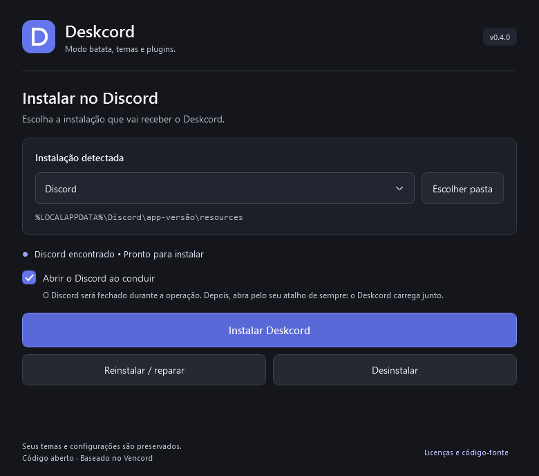

# Deskcord

Mod do Discord para Windows com controles reversíveis de desempenho, temas CSS locais e plugins sob demanda. Fork independente do [Vencord](https://github.com/Vendicated/Vencord), sob GPL-3.0-or-later; não é afiliado ao Discord nem uma distribuição oficial do Vencord.



Este repositório reúne o código-fonte do cliente **0.7.0**, a documentação, as licenças e **169 pacotes compilados**, incluindo dependências internas. O catálogo contém **155 plugins públicos com pacotes experimentais**, além dos identificados como indisponíveis. A compilação não garante compatibilidade individual com o Discord atual.

## Publicar e conectar

1. Publique o conteúdo desta pasta no repositório público [trwsty/deskcord](https://github.com/trwsty/deskcord), na branch `main`. Siga [Publicar no GitHub](docs/PUBLICAR_NO_GITHUB.md).
2. Configure o endereço dos pacotes conforme [Conectar os downloads](docs/CONECTAR_DOWNLOADS.md).
3. Abra o Discord → Configurações → Plugins. Ao ativar, o Deskcord baixa apenas o plugin escolhido e suas dependências. Reinicie para carregá-los.

O upload sozinho não altera o endereço configurado nos clientes já instalados. Não use o link de uma página `github.com/.../tree/...` como endereço de download.

## Organização

| Pasta | Conteúdo |
| --- | --- |
| `src/` | Código do Deskcord, integrações nativas, catálogo e fontes dos plugins |
| `installer/windows/` | Interface e código do instalador EXE |
| `scripts/` | Build, empacotamento, preparação e verificação |
| `tests/` | Testes do núcleo, plugins e instalador |
| `docs/` | Publicação, downloads, validação e limitações |
| `plugin-packages/d07030c0968e31e41caa0c35fda0ef8ae63a079e/` | Arquivos individuais baixados pelo cliente e catálogo correspondente |
| `licenses/` | Avisos e licenças das dependências distribuídas |

Os pacotes mantêm nomes com SHA-256. Preserve os arquivos e as pastas de revisões anteriores: clientes antigos ainda podem depender deles. `.gitattributes` evita que o Git altere as quebras de linha dos pacotes, o que invalidaria seus hashes.

## Desenvolvimento

Requer Node.js 22+ e pnpm. Para compilar o EXE, use Windows com o compilador .NET Framework. O usuário final do instalador não precisa instalar Node.

```sh
pnpm install --frozen-lockfile
pnpm test
pnpm test:ui
pnpm package:deskcord
```

Confira os arquivos publicados sem executar código dos plugins:

```sh
node scripts/deskcord/verify-github.mjs
```

Detalhes do cliente: [README-CLIENTE.md](README-CLIENTE.md). Limitações e evidências: [docs/VALIDATION.md](docs/VALIDATION.md). Arquitetura da distribuição: [docs/PLUGIN_DISTRIBUTION.md](docs/PLUGIN_DISTRIBUTION.md).

## Limites

O modo batata não elimina o consumo base do Electron nem promete uma redução específica de RAM. Plugins de outros clientes precisam de adaptação. Badges, pagamentos e atualizador remoto não estão implementados. O EXE ainda não tem assinatura digital. Mods não autorizados contrariam os [termos do Discord](https://discord.com/terms).

## Licença e autoria

Preserve [LICENSE](LICENSE), [NOTICE.md](NOTICE.md), os avisos dos arquivos e `licenses/`. As autorias originais dos plugins constam no catálogo. Quem redistribui o cliente ou os pacotes precisa também manter acesso ao código-fonte correspondente, às licenças e aos scripts de compilação. Esta pasta contém esse código; publique-a completa e preserve a revisão associada aos downloads.
